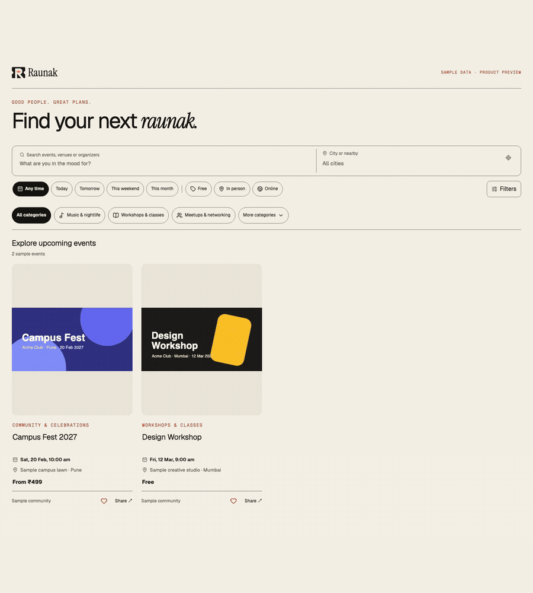
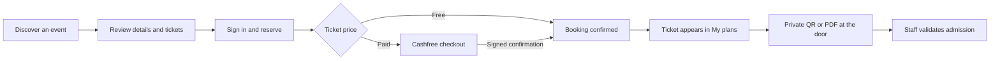
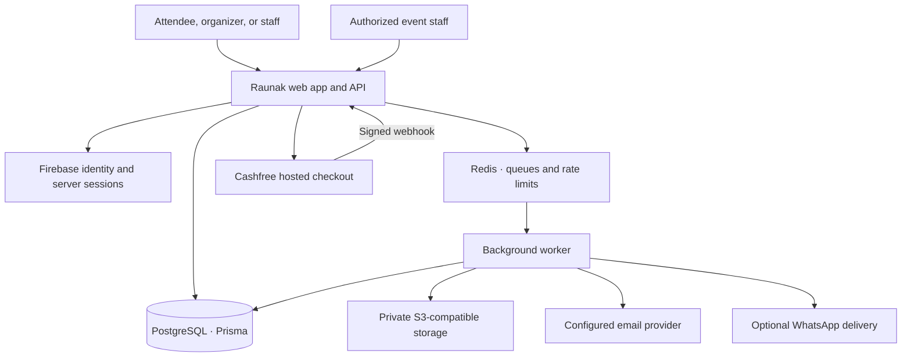

<p align="center">
  
</p>

<h1 align="center">Make room for a little raunak.</h1>

<p align="center">
  An India-first event platform for finding good plans, bringing people together,
  and making the door feel effortless.
</p>

<p align="center">
  <a href="https://raunak.yaduraj.me"><strong>Explore Raunak ↗</strong></a>
  &nbsp; · &nbsp;
  <a href="docs/public/introduction.md">Product guide</a>
  &nbsp; · &nbsp;
  <a href="docs/public/installation.md">Private setup notes</a>
</p>

<p align="center">
  
  
  
  
</p>

<br />

## One plan, all the way to the door

Raunak connects the moments around an event: discovering something worth going to, giving an organizer the tools to host it, and helping every guest find their way in.

<p align="center">
  
</p>

<p align="center"><sub>Product interface reel · Fictional sample data · No real bookings, customers, or usable admission codes</sub></p>

<details>
  <summary>See the product screens</summary>
  <br />
  <table>
    <tr>
      <td width="33%"></td>
      <td width="33%"></td>
      <td width="33%"></td>
    </tr>
    <tr>
      <td align="center"><strong>Find your next plan</strong></td>
      <td align="center"><strong>Bring an event to life</strong></td>
      <td align="center"><strong>Welcome guests confidently</strong></td>
    </tr>
  </table>
</details>

The images show real Raunak components captured in a local preview with intercepted sample data. They are product previews—not customer activity, ticket sales, event partnerships, or proof of live provider delivery. See [asset provenance](public/docs-assets/ASSETS.md).

## The experience

### For people going out

Browse public events without being forced into a city filter. Search by event, venue, or organizer; narrow by date, category, format, and price; save a plan for later; then book with a clear order summary. Confirmed tickets live in **My plans**, where guests can open their private admission QR, download a ticket PDF, and get the details they need on event day.

### For people bringing everyone together

Create an organizer workspace, shape an event page, add a gallery and lineup, set ticket tiers and inventory, and request publication review. Once approved and published, the event can appear in discovery. Organizers can manage attendees, messages, staff access, and entrance check-in from the same workspace.

### At the entrance

Staff can scan a ticket QR or look up a guest manually. The server validates the ticket against its event and booking, records admission, and warns when a ticket is already used, cancelled, or otherwise not valid for entry.

## The guest journey



Every admission ticket has its own signed identity. A public event URL is shareable; a ticket QR or signed admission URL is private and should not be forwarded.

## What is in Raunak

| Experience | Product capabilities |
| --- | --- |
| **Discover** | Server-backed event search, city suggestions, nearby discovery, date/category/format/price filters, saved events, public organizer profiles, and shareable filter URLs. |
| **Host** | Workspaces and roles, event drafts, image uploads and cropping, galleries, lineups, ticket inventory, publication review, attendee management, and event messaging. |
| **Book** | Account-owned orders, free bookings, Cashfree hosted checkout when configured, inventory holds, payment verification, and duplicate-confirmation protection. |
| **Deliver** | Signed QR tickets, downloadable PDFs, email notifications, optional WhatsApp delivery, retries, and delivery logs. |
| **Welcome** | Camera scanning, manual attendee lookup, server-side admission validation, duplicate-entry warnings, and check-in records. |
| **Reflect** | Post-event reviews from eligible attendees, with rating summaries and practical event tips. |

These are implemented product flows. Their availability in a particular environment still depends on provider configuration, credentials, approvals, connected devices, and operational acceptance.

## How the platform fits together



The web app owns authorization, reservations, and payment confirmation. The worker handles media processing, ticket PDFs, notifications, and maintenance. The payment return page alone never proves that a payment succeeded; the verified provider response does. For implementation boundaries, see the [architecture guide](docs/public/architecture.md).

## Built around trust

- **Private by default:** ticket files and original uploads are private; ticket reads check ownership on the server.
- **Admission is verified:** signed QR tokens are validated against event, booking, and ticket state at check-in.
- **Payment is confirmed server-side:** Cashfree webhook signatures and order state are part of the booking flow.
- **Publication has a gate:** organizer submissions go through platform review before public discovery.
- **No invented marketplace:** the product does not fabricate events, attendees, reviews, or sales to make a page look busy.
- **Provider limits stay visible:** configured code does not imply successful settlement, inbox placement, WhatsApp delivery, or real-device acceptance.

## Project status and boundaries

Raunak is a privately maintained personal product project. The repository is not a public starter kit or an invitation for public contributions. Explore the live product at [raunak.yaduraj.me](https://raunak.yaduraj.me); the source, operating configuration, and internal tooling remain private.

| Capability | Current boundary |
| --- | --- |
| Payments | Cashfree hosted checkout and signed payment verification are implemented. Organizer split settlements are not available until the merchant account supports an appropriate marketplace payout setup. |
| WhatsApp | Delivery depends on the event’s configured channel, attendee consent, sender availability, and provider rules. WhatsApp PDF attachments are controlled by message settings; email tickets include the PDF. |
| Email | Resend/SMTP can be configured. A successful provider request does not guarantee inbox placement. |
| Maps | Geoapify supports city/address lookup. Manual venue entry remains available without the provider key. |
| Admin review | The review console is restricted by a server-side Firebase UID allowlist; there is no public admin registration. |

See the private [integration notes](docs/public/integrations.md) and [environment reference](docs/public/reference.md) for configuration details. Do not place credentials, real attendee information, payment identifiers, or usable ticket links in this repository.

## Local development

These instructions are for the project owner and approved maintainers. Use disposable local services and development credentials. The local Compose setup provides PostgreSQL, Redis, S3-compatible storage, and Mailpit; Firebase requires a separate development project.

**Requirements:** Node.js 24, pnpm 10.12.4, Docker Compose, and Firebase development configuration.

```bash
corepack enable
corepack prepare pnpm@10.12.4 --activate
pnpm install --frozen-lockfile
cp .env.example .env
docker compose up -d
```

Set the public `NEXT_PUBLIC_FIREBASE_*` values and server-only `FIREBASE_*` credentials in `.env`. Enable the sign-in providers you plan to use and authorize `localhost` in Firebase. Never put a server service account in a browser variable.

Generate different random values for `TICKET_SIGNING_SECRET` and `ENCRYPTION_KEY`:

```bash
node -e "console.log(require('node:crypto').randomBytes(32).toString('hex'))"
```

Then prepare the database and run the web app and worker in separate terminals:

```bash
pnpm exec prisma generate
pnpm db:migrate
pnpm dev
```

```bash
pnpm worker
```

Open [localhost:3000](http://localhost:3000). The local docs live at [localhost:3000/docs](http://localhost:3000/docs). `/api/health` checks web reachability only; it does not prove that the database, worker, or providers are ready.

| Local service | Address |
| --- | --- |
| Web app and product docs | `http://localhost:3000` · `http://localhost:3000/docs` |
| PostgreSQL | `localhost:5433` |
| Redis | `localhost:6379` |
| S3-compatible storage | `http://localhost:9000` |
| Mailpit inbox / SMTP | `http://localhost:8025` · `localhost:1025` |

For details, use the [installation guide](docs/public/installation.md), [development notes](docs/public/development.md), and [environment reference](docs/public/reference.md). Seeding is optional; never run it against production or a database containing customer records.

## Technology

| Layer | Tools |
| --- | --- |
| Web application | Next.js 16, React 19, TypeScript, Tailwind CSS 4 |
| Identity | Firebase Auth and server-managed sessions |
| Data | PostgreSQL and Prisma 7 |
| Background work | Redis, BullMQ, and a separate worker process |
| Media and documents | S3-compatible private storage |
| Payments and delivery | Cashfree, Resend/SMTP, optional Meta or linked WhatsApp gateway |
| Quality | Vitest, Playwright, and axe accessibility checks |

## Repository map

```text
src/app/             Product pages, API routes, and product documentation
src/components/      Attendee, organizer, admin, and shared interface
src/server/          Authentication, bookings, payments, tickets, and providers
prisma/              Data model and database migrations
worker/              Media, ticket PDF, notifications, and maintenance jobs
services/            Optional long-running WhatsApp gateway
public/docs-assets/  Raunak brand artwork and safe product previews
tests/               Unit, integration, and browser coverage
deploy/              Installation-specific production configuration
```

## Owner checks

```bash
pnpm typecheck
pnpm lint
pnpm exec vitest run tests/unit
pnpm build
```

Integration and browser checks need their documented local services and disposable data. Mocked payment or messaging tests verify application behavior only; they do not prove a live charge, merchant settlement, message delivery, or physical scanner acceptance. See the [development guide](docs/public/development.md) before running the wider suite.

## Private project notice

**Raunak is proprietary software maintained by Yaduraj Singh.** Repository access is limited to the project owner and people explicitly invited to work on it. No license or permission to use, copy, modify, distribute, or reuse this source or its brand assets is granted by viewing this repository. Third-party packages and assets remain subject to their own licenses.

<p align="center"><strong>Good people. Great plans.</strong><br />Built with care by Yaduraj Singh.</p>
