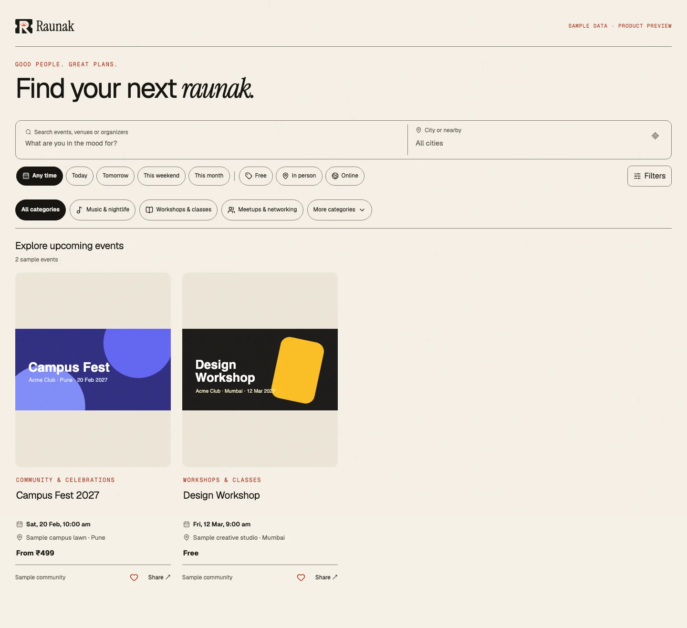
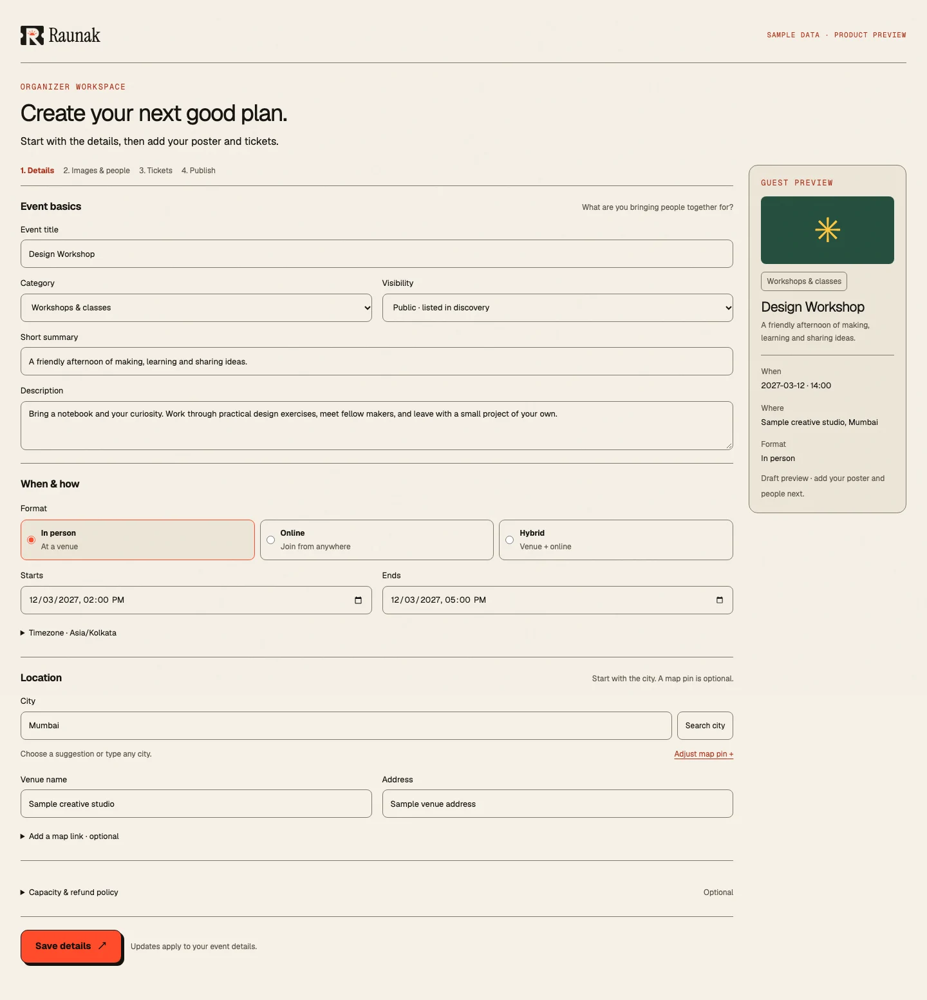
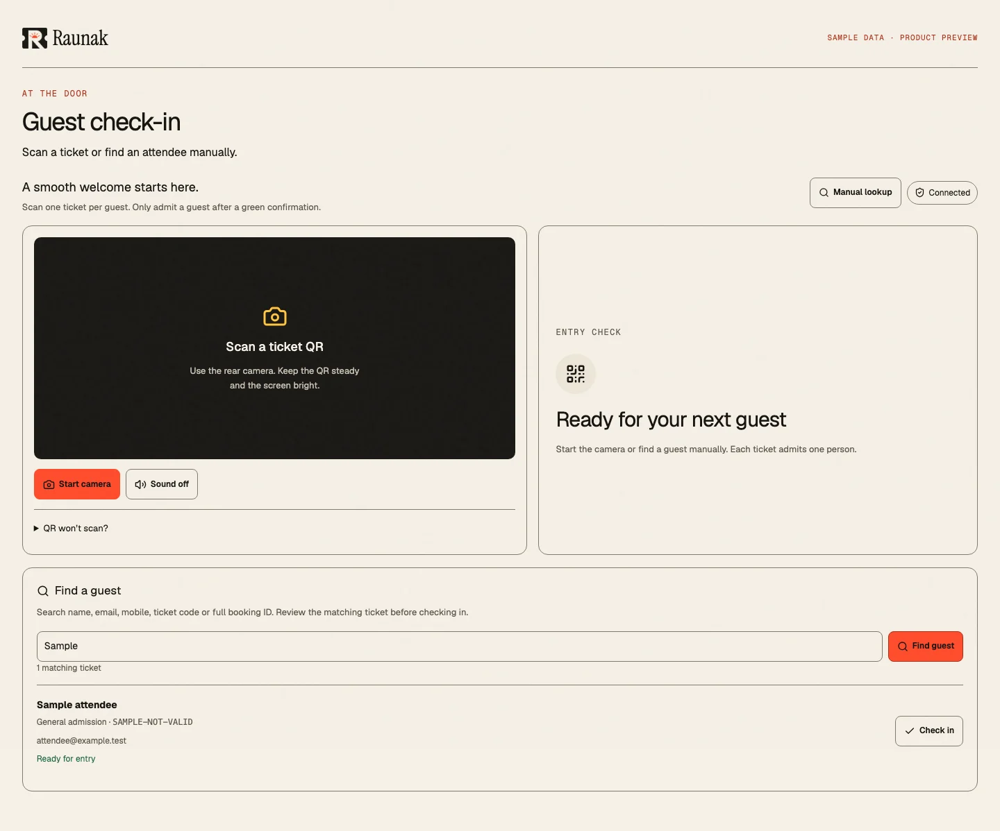
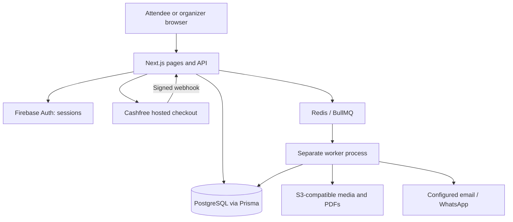

<p align="center">
  
</p>

<p align="center">
  Raunak brings event discovery, organizer tools, ticket bookings and QR check-in<br />
  into one India-first platform. For college fests, workshops, community meetups,<br />
  comedy nights and more.
</p>

<p align="center">
  <a href="LICENSE"></a>
  
  
</p>

<p align="center">
  <a href="https://raunak.yaduraj.me">Open Raunak</a> ·
  <a href="#getting-started">Get started</a> ·
  <a href="docs/public/introduction.md">Documentation</a> ·
  <a href="CONTRIBUTING.md">Contribute</a>
</p>

## A plan, from discovery to the door



<table>
  <tr>
    <td width="50%"></td>
    <td width="50%"></td>
  </tr>
  <tr>
    <td>Give every event its own home.</td>
    <td>Find the booking. Check the ticket. Welcome the guest.</td>
  </tr>
</table>

Screenshots show actual application components with fictional sample data. They are interface previews, not customer activity or performance evidence. No usable admission QR is included. See the [asset capture notes](docs/docs-maintenance.md).

## What Raunak does

Raunak connects the work of running an event with the experience of attending it. The interface uses warm cream, ink, vermilion and editorial typography, with responsive light and dark themes. The examples above illustrate possible uses; no customer or event-partner affiliation is implied.

**For attendees:** discover an event, choose available tickets, sign in, complete a free booking or configured Cashfree checkout, then open the booking's admission QR at the door. My plans brings tickets, saved events and orders together. Booking requires an account; knowing a reference number alone does not grant access to a ticket.

**For organizers:** create a workspace, add event details and media, configure ticket prices and inventory, and submit the event for platform review. Approved published public listings become discoverable. Manage bookings, delivery status and entrance staff from the same workspace.

## Core capabilities

| Area | Included behavior |
| --- | --- |
| Discovery | Server-backed search, city suggestions, dates, categories, format and price filters, nearby discovery with permission, saved events and public organizer profiles. |
| Hosting | Workspace roles, event drafts, media uploads/cropping, gallery and lineup management, ticket inventory, publication review and an admin queue. |
| Booking | Account-owned orders, free tickets, Cashfree hosted checkout, inventory holds, payment validation and duplicate-confirmation handling. |
| Delivery | Signed admission QR, PDF tickets, configurable email and optional WhatsApp delivery, retries and delivery logs. |
| Entrance | Camera scanning, manual lookup, permission checks and duplicate/cancelled/refunded-ticket feedback. |
| Reviews | One editable review per eligible attendee after an event ends, with real rating summaries and practical attendee tips. |

Presence in this table means the behavior exists in the repository. Provider configuration and real-world acceptance are separate requirements, detailed below.

## How it works



The web process handles pages, authorization, reservations and payment confirmation. Ticket records are issued in the booking/payment transaction; background jobs prepare PDFs, process images, deliver notifications and recover pending work. Expired holds return inventory. A browser redirect is not proof of payment. See the [architecture and booking lifecycle](docs/public/architecture.md) for transaction and queue boundaries.

## Getting started

Use a disposable development environment. You need **Node.js 24**, **pnpm 10.12.4**, Docker with Compose, and a Firebase development project. The local Compose file supplies PostgreSQL 16, Redis 7, S3-compatible LocalStack and Mailpit; it does not provision Firebase.

```bash
git clone https://github.com/YadurajManu/raunak.git
cd raunak
corepack enable
corepack prepare pnpm@10.12.4 --activate
pnpm install --frozen-lockfile
cp .env.example .env
docker compose up -d
```

Before opening the app, configure both public `NEXT_PUBLIC_FIREBASE_*` values and server `FIREBASE_*` credentials in `.env`. Enable Email/Password and any intended Google sign-in provider, and authorize `localhost` in Firebase. Keep the server private key out of browser variables. Firebase configuration is required for real sign-in and booking; there is no local auth bypass.

Generate **two separate** secrets and paste them into `TICKET_SIGNING_SECRET` and `ENCRYPTION_KEY`:

```bash
# Run twice; use a different output for each variable.
node -e "console.log(require('node:crypto').randomBytes(32).toString('hex'))"
```

Then prepare the database and start the web process:

```bash
pnpm exec prisma generate
pnpm db:migrate
pnpm dev
```

In another terminal, start the background worker:

```bash
pnpm worker
```

Open [localhost:3000](http://localhost:3000). Check the web process with `curl -f http://localhost:3000/api/health`; this reachability endpoint does not prove provider or worker readiness. The credential-independent documentation site is at [localhost:3000/docs](http://localhost:3000/docs). The [installation guide](docs/public/installation.md) covers services, environment setup and common failures.

| Local service | Address |
| --- | --- |
| Web / documentation | `http://localhost:3000` / `http://localhost:3000/docs` |
| PostgreSQL | `localhost:5433` |
| Redis | `localhost:6379` |
| S3 endpoint | `http://localhost:9000` |
| Mailpit inbox / SMTP | `http://localhost:8025` / `localhost:1025` |

Seeding is optional and is excluded from this quick start. Inspect the current seed entry point before running it against a development database; database sample users do not create Firebase sign-in accounts. Never run sample seeding against customer data.

## Configuration and integration status

| Integration | Required configuration and limits |
| --- | --- |
| Firebase | Browser project config and server service account for signed sessions. No guest checkout. |
| Cashfree | Sandbox/production credentials, approved checkout domain and `/api/webhooks/cashfree`. Code supports checkout and verification; this documentation change does not verify live settlement. Organizer bank split payouts are not implemented. |
| Media and PDFs | `S3_*` credentials, bucket policy and CORS. LocalStack is provided locally; production storage must be private where expected. |
| Email | Local SMTP through Mailpit, or configured SMTP/Resend and a verified sender. Delivery code does not guarantee inbox placement. |
| Official WhatsApp | Meta credentials, connected sender, attendee consent and approved template mapping. This is separate from the linked gateway. |
| Optional linked WhatsApp | Private long-lived Baileys gateway, explicit enable flag and encrypted sessions. Automated tests do not establish real-phone acceptance; disconnection or account restrictions remain possible. |
| Location | Geoapify for address lookup; manual entry remains available without a key. Retain map-provider attribution. |
| Platform review | `/admin` uses the server-only `RAUNAK_ADMIN_FIREBASE_UIDS` allowlist; there is no public admin sign-up. |

See [integrations](docs/public/integrations.md) and the [environment reference](docs/public/reference.md). Keep `.env`, service credentials, signing keys and real ticket links out of commits. Provider accounts, domain approvals and costs are operator responsibilities. This task adds documentation, not activation of any provider.

## Stack and repository

| Layer | Repository stack |
| --- | --- |
| Application | Next.js 16, React 19, TypeScript, Tailwind CSS 4 |
| Data and authentication | Prisma 7, PostgreSQL 16, Firebase Auth |
| Background work | Redis / BullMQ; separate Node.js worker |
| Providers | Cashfree, S3-compatible storage, Resend/SMTP, optional Meta or Baileys WhatsApp |

```text
src/app/              Application pages, /docs and API routes
src/components/       Shared, public, organizer and docs interfaces
src/server/           Auth, events, checkout, admission and providers
prisma/               Data model and migrations
worker/               Media, PDF, notification and maintenance jobs
docs/public/          Explicitly published Markdown guides
public/docs-assets/   Checked-in banner and safe product screenshots
tests/                Vitest and Playwright coverage
deploy/               Existing production installation configuration
```

Raunak is the public product name. Some internal identifiers retain the original Eventra codename; no package or database rename is required to use the project.

## Develop, verify and operate

```bash
pnpm exec next typegen
pnpm typecheck
pnpm lint
pnpm exec vitest run tests/unit
pnpm build
pnpm exec playwright install chromium
pnpm exec playwright test tests/e2e/docs.spec.ts
```

`pnpm test` also includes integration tests, which need disposable services and provider test settings. Browser coverage has its own environment requirements; consult test files before enabling fixtures. A passing mocked payment test establishes code behavior, not live financial settlement, email deliverability or phone-camera performance.

Production needs `pnpm build` / `pnpm start`, a separate worker, applied migrations, HTTPS and provider configuration. The checked-in production Compose file describes a specific installation with private routing and storage assumptions. Use the [public deployment guide](docs/public/deployment.md) to understand requirements before adapting it. Back up persistent data and retain a rollback image.

The [documentation directory](docs/public/introduction.md) covers product workflows, architecture, integrations and operations. To change a page, update canonical Markdown and its explicit metadata entry; [maintainer instructions](docs/docs-maintenance.md) explain navigation, search, screenshots and verification.

## Contributing, security and license

Focused improvements, accessibility fixes, bug reports and clearer guides are welcome. Follow [CONTRIBUTING.md](CONTRIBUTING.md) for setup, checks and pull requests. Report sensitive issues through the private channel described in [SECURITY.md](SECURITY.md); do not post credentials, attendee information or admission links publicly.

Raunak's original source is available under the [MIT License](LICENSE). Third-party dependencies, fonts and assets retain their own license terms. Provider access and services are separate from the source license.

<p align="center"><strong>A little less admin. A lot more event.</strong></p>
