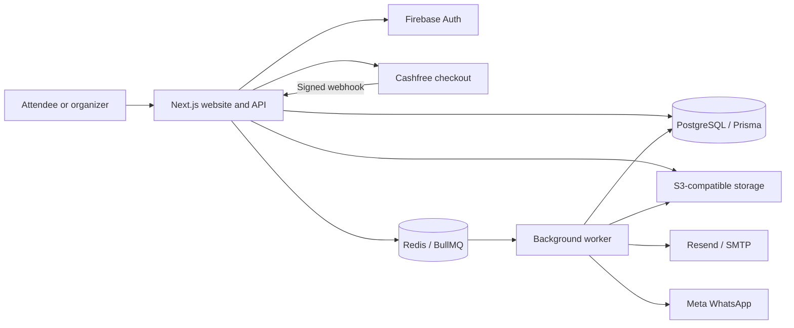

<p align="center">
  
</p>

<p align="center">
  <strong>An India-first platform for discovering, hosting and showing up.</strong><br />
  From the first invitation to the QR scan at the door.
</p>

<p align="center">
  <a href="LICENSE"></a>
  
  
  
  
</p>

<p align="center">
  <a href="https://raunak.yaduraj.me">Live website</a> ·
  <a href="#getting-started">Get started</a> ·
  <a href="#features">Features</a> ·
  <a href="CONTRIBUTING.md">Contribute</a>
</p>

---

## Meet Raunak

Raunak brings event discovery, organizer workspaces, ticketing and admission into one application. Attendees can find a plan, book a ticket and open their QR at the entrance. Organizers can publish events, manage media and ticket inventory, track bookings and check guests in.

The interface pairs warm cream, dark ink, coral and deep green with editorial typography, responsive layouts and light/dark themes. **Eventra** was the working codename; some internal package, database and development identifiers retain that name.

## Features

### For attendees

- **Discover real events:** server-backed search, event/venue/organizer suggestions, city autocomplete, recent cities and optional nearby search.
- **Find the right plan:** date shortcuts, custom ranges, categories, free/paid filters, price ranges, event formats and sorting, with shareable URL filters.
- **Keep your favorites:** persistent saved events and public organizer profiles.
- **Book tickets:** free bookings and Cashfree hosted checkout, inventory holds and verified payment webhooks.
- **Carry your tickets:** an account-owned wallet, individual admission QR codes, private PDF downloads and permitted resends.
- **Share and remember:** WhatsApp links, clipboard copying, native sharing where available, Google Calendar, Outlook and ICS exports.
- **Stay signed in:** Firebase email/password and Google authentication, remembered sessions, onboarding and a dedicated profile editor.

### For organizers

- **Separate workspaces:** team invitations, role-based access and assigned event staff.
- **Create and publish:** timezone-aware schedules, venue pins, online/hybrid formats, validation and publication review guidance.
- **Manage media:** upload progress, background processing, crop/aspect-ratio editing, galleries, lineup profiles and PDF attachments.
- **Control tickets:** prices, sale windows, capacity and quantity limits.
- **Run the event:** attendee search, CSV exports, booking/delivery status, QR/manual check-in and duplicate-entry protection.
- **Handle changes:** event duplication, cancellation and payment/refund operations.

> **Integration status:** Cashfree, Resend/SMTP and WhatsApp delivery code is implemented. Actual payments and delivery require configured provider accounts. Official WhatsApp uses a production sender and approved templates; the optional Baileys gateway uses a deliberately linked number. Both require attendee consent. Real-phone Baileys acceptance is pending. Guest checkout and a platform moderation queue are not implemented.

## Stack

| Layer           | Technology                                                |
| --------------- | --------------------------------------------------------- |
| Application     | Next.js 16 App Router, React 19, TypeScript               |
| Interface       | Tailwind CSS 4, shared brand styles, Lucide icons         |
| Motion          | Motion, GSAP and Lenis, with reduced-motion support       |
| Database        | PostgreSQL 16, Prisma 7 with the PostgreSQL adapter       |
| Authentication  | Firebase Auth and server-side session cookies             |
| Background jobs | Redis 7 and BullMQ                                        |
| Media           | S3-compatible storage, Sharp and HEIC conversion          |
| Payments        | Cashfree hosted checkout and signed webhooks              |
| Delivery        | Resend or SMTP; Meta Cloud API or private Baileys gateway |
| Maps            | MapLibre GL and optional Geoapify geocoding               |
| Tickets         | Signed QR codes, React PDF and ZXing scanning             |
| Testing         | Vitest and Playwright                                     |

### Architecture



The web process serves the interface and API. A separate worker processes artwork, prepares ticket PDFs, delivers notifications and maintains order expiry. Run both for the complete workflow.

## Getting started

### Prerequisites

- Node.js **24** and pnpm **10.12.4**.
- Docker with Docker Compose.
- A Firebase project for authenticated features.
- Cashfree sandbox credentials when testing paid checkout.

### 1. Clone and start local services

```bash
git clone https://github.com/YadurajManu/raunak.git
cd raunak
pnpm install --frozen-lockfile
cp .env.example .env
docker compose up -d
```

The root Compose file starts development PostgreSQL, Redis, LocalStack S3 and Mailpit. Give services time to initialize before migrating or uploading files.

### 2. Configure your environment

Edit `.env` using [.env.example](.env.example) as the complete reference. Keep `APP_URL=http://localhost:3000` for the default port; origin checks require it to match your browser URL.

Enable **Email/Password** and **Google** in Firebase Authentication, register its web app and authorize `localhost`. Add the four `NEXT_PUBLIC_FIREBASE_*` values and server service-account values. In the quoted `FIREBASE_PRIVATE_KEY`, represent line breaks as `\n`. Never put a service-account key in a `NEXT_PUBLIC_*` variable.

Generate **separate** values for `TICKET_SIGNING_SECRET` and `ENCRYPTION_KEY`:

```bash
openssl rand -hex 32
```

Paste a newly generated value into each setting. Keep local email on SMTP/Mailpit and payment testing on `CASHFREE_ENV=sandbox`.

### 3. Prepare the database and run

```bash
pnpm exec prisma generate
pnpm db:migrate
pnpm dev
```

In another terminal:

```bash
pnpm worker
```

| Local service          | Address                          |
| ---------------------- | -------------------------------- |
| Application            | http://localhost:3000            |
| Health endpoint        | http://localhost:3000/api/health |
| Mailpit inbox          | http://localhost:8025            |
| PostgreSQL             | `localhost:5433`                 |
| Redis                  | `localhost:6379`                 |
| S3-compatible endpoint | http://localhost:9000            |

**Optional demo data:** run `pnpm db:seed` against a development database. It adds fictional events; it does not provision Firebase sign-in accounts. Never seed a production database.

## Configuration

The QR-linked WhatsApp extension uses a private, long-lived gateway pinned to `baileys@7.0.0-rc14`. Owners/admins link a dedicated number by QR or pairing code at `/dashboard/settings/whatsapp`, choose a mode, and edit workspace/event messages with ticket-card/PDF attachments. Auth is encrypted in PostgreSQL; Redis holds renewable ownership locks, expiring QR codes, caps and duplicate-send results. It is disabled by default and cannot run on serverless. See the [gateway runbook and phone QA checklist](docs/whatsapp-gateway.md).

**Unofficial connection risk:** WhatsApp may disconnect or restrict the linked number, and upstream changes can break delivery. Traffic controls are conservative heuristics, not protection guarantees. Email remains independent. The official Meta provider is preserved for approved-template delivery. No campaigns or group messaging are supported.

Set `WHATSAPP_PROVIDER=baileys`, configure `WA_GATEWAY_API_KEY`, `WA_GATEWAY_URL`, and a 32-byte `ENCRYPTION_KEY` (64 hex characters or base64), then deliberately enable `WA_UNOFFICIAL_ENABLED=true`. Run `pnpm --filter @raunak/wa-gateway start` alongside the existing worker. Production uses the private `whatsapp` Compose profile; never expose the gateway port through Caddy, Cloudflare Tunnel, or a public load balancer. Back up the encryption key separately; changing it without re-encrypting stored sessions requires re-linking. See the runbook for key rotation and runtime kill-switch steps.

| Area                    | Environment variables                                                                                                                     | Purpose                                                       |
| ----------------------- | ----------------------------------------------------------------------------------------------------------------------------------------- | ------------------------------------------------------------- |
| Application             | `APP_URL`                                                                                                                                 | Canonical URL, origin checks and links                        |
| Data                    | `DATABASE_URL`, `REDIS_URL`                                                                                                               | Database and background queues                                |
| Browser authentication  | `NEXT_PUBLIC_FIREBASE_*`                                                                                                                  | Public Firebase web configuration                             |
| Server authentication   | `FIREBASE_PROJECT_ID`, `FIREBASE_CLIENT_EMAIL`, `FIREBASE_PRIVATE_KEY`                                                                    | Session verification and account administration               |
| Payments                | `CASHFREE_ENV`, `CASHFREE_APP_ID`, `CASHFREE_SECRET_KEY`, `CASHFREE_API_VERSION`                                                          | Checkout and webhook verification                             |
| Storage                 | `S3_*`, `AWS_REQUEST_CHECKSUM_CALCULATION`                                                                                                | Media uploads, variants and private files                     |
| Email                   | `EMAIL_PROVIDER`, `EMAIL_FROM`, `RESEND_API_KEY` or `SMTP_*`                                                                              | Invitations, receipts and ticket delivery                     |
| WhatsApp                | `WHATSAPP_*`                                                                                                                              | Sender credentials, webhook verification and template mapping |
| Linked WhatsApp gateway | `WA_GATEWAY_*`, `WA_UNOFFICIAL_ENABLED`, `WA_MAX_DAILY`, `WA_PER_RECIPIENT_DAILY`, `WA_MIN_DELAY_MS`, `WA_MAX_DELAY_MS`, `WA_ADMIN_EMAIL` | Private engine, traffic controls and connection alerts        |
| Location                | `GEOAPIFY_API_KEY`, `NEXT_PUBLIC_MAP_TILE_URL`, `NEXT_PUBLIC_MAP_ATTRIBUTION`                                                             | Address lookup and map rendering                              |
| Signing                 | `TICKET_SIGNING_SECRET`, `ENCRYPTION_KEY`                                                                                                 | Server-side cryptographic configuration                       |

For production email, select `EMAIL_PROVIDER=resend` and use a sender on a verified domain. Payment and messaging providers need their corresponding configuration; credentials are not included.

Without Geoapify, manual city entry and the map remain available. Choose a tile provider appropriate for your traffic and retain its required attribution.

## Development and verification

```bash
pnpm exec next typegen
pnpm typecheck
pnpm lint
pnpm test
pnpm build
pnpm exec playwright install chromium
pnpm test:e2e
```

Database and storage integration tests require local services and a migrated **development/test database**. Browser tests start the development server unless `PLAYWRIGHT_BASE_URL` points to an existing instance. Some onboarding tests require opt-in fixture settings; check the test files before enabling them.

Additional local checks are in `scripts/verify-experience.ts`, `scripts/verify-site-polish.ts` and `scripts/verify-event-actions.ts`. They use disposable accounts or records and may require Firebase test-project credentials. Target the matching local environment. Generated screenshots and reports belong in the ignored `artifacts/` directory.

Tests exercise payment logic with injected providers. A passing suite does not establish live settlement, deliverability or physical-device camera behavior.

## Project structure

```text
src/
  app/                 Pages, shared layouts and API routes
  components/          Marketing, attendee and organizer components
  config/              Categories, cities, pricing and product configuration
  lib/                 Shared validation, formatting and browser helpers
  server/              Authentication, events, checkout, tickets and providers
prisma/                Schema, migrations and optional development seed
worker/                Media, ticket, notification and order-maintenance jobs
tests/                 Unit, integration and Playwright tests
scripts/               Verification and maintenance tools
docker/                Development storage initialization
deploy/                Production Compose and Caddy configuration
docs/                  Design, architecture and integration notes
```

## Deployment

Build and run the web process with `pnpm build` and `pnpm start`, and run `pnpm worker` separately. Apply migrations before starting code that depends on them. Configure HTTPS, Firebase authorized domains, provider webhooks, storage CORS and private access policies.

The [Dockerfile](Dockerfile) and [production Compose file](deploy/compose.yml) describe the existing server deployment. That Compose file expects a Fleet network, Caddy routing and Garage storage configuration; it is not a generic one-click deployment. See the [deployment runbook](docs/deployment.md) for that installation.

Keep environment files outside images and Git, back up database and storage, and retain the previous image before a release. Paid checkout requires Cashfree domain approval and its webhook at `/api/webhooks/cashfree`. Never use `docker compose down -v` on an installation whose data you need.

## Documentation

| Guide                                                   | Contents                                       |
| ------------------------------------------------------- | ---------------------------------------------- |
| [Brand foundation](docs/brand.md)                       | Colors, typography and visual patterns         |
| [Navigation architecture](docs/universal-navigation.md) | Navbar, layout boundaries and Discover         |
| [Discovery and wallet](docs/discovery-wallet.md)        | Search, bookmarks, ownership and ticket states |
| [Media editor](docs/media-editor-redesign.md)           | Uploading, cropping, galleries and lineup      |
| [Payments and delivery](docs/payments-whatsapp.md)      | Cashfree webhooks and WhatsApp activation      |
| [Event operations](docs/event-operations.md)            | Organizer workflows and event management       |
| [WhatsApp configuration](docs/whatsapp.md)              | Sender, webhook and template setup             |
| [Deployment](docs/deployment.md)                        | Existing server installation and rollback      |

## Contributing

Bug reports, accessibility fixes, clearer documentation and focused improvements are welcome. Read [CONTRIBUTING.md](CONTRIBUTING.md) for setup, checks and pull-request expectations. For vulnerabilities, follow [SECURITY.md](SECURITY.md) rather than posting sensitive details in an issue.

## License

Raunak's original source code is available under the [MIT License](LICENSE). Third-party packages, fonts and assets retain their respective licenses. Provider accounts and services are separate from the source-code license.

---

<p align="center"><strong>A little less admin. A lot more event.</strong><br />Made for getting together.</p>
