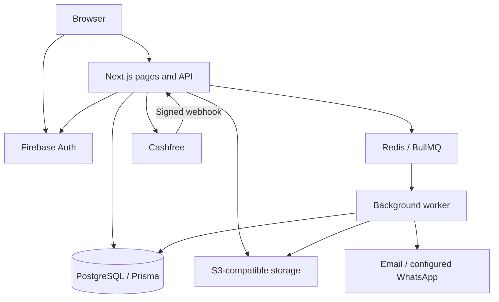
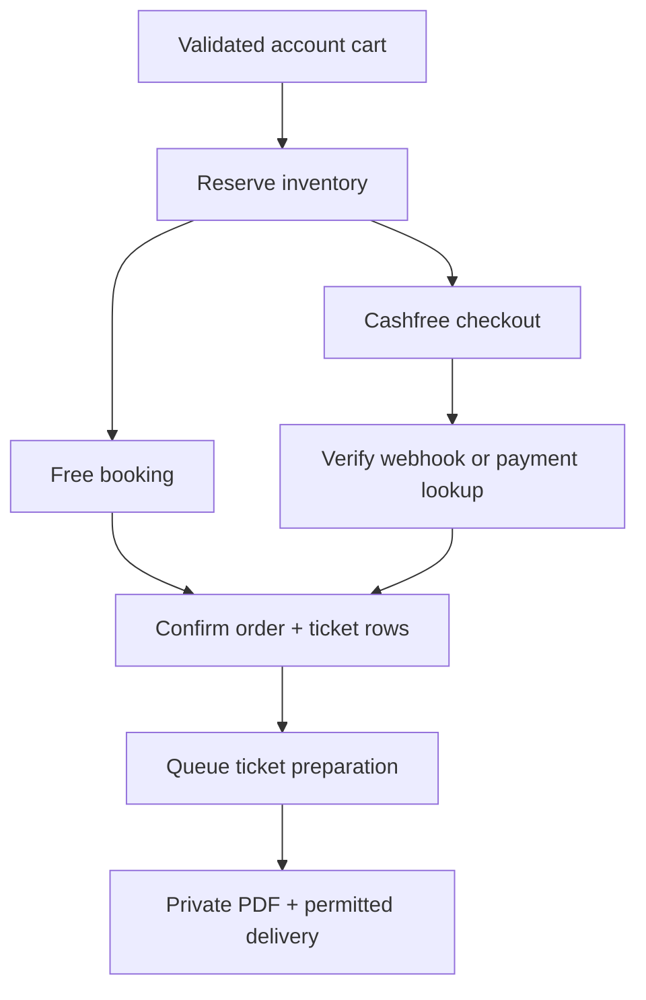

# Architecture and booking lifecycle

Raunak is one Next.js web application with a separate background worker. PostgreSQL holds durable application state; Redis/BullMQ schedules work; S3-compatible storage holds artwork and private ticket files.

## Services at a glance

The browser signs in through Firebase. The server verifies the identity token, creates an HTTP-only session cookie and maps the Firebase UID to an application user. Workspace/event roles and booking ownership are checked server-side.

The web process serves public discovery, event details, account pages, organizer tools and API routes. A separate worker handles image transformation, ticket preparation, notification delivery and maintenance. Redis queues are not the sole record of payment or delivery state: durable database records support recovery.

## Reserve inventory

`createCheckout` validates the account-owned cart, ticket quantities, sale windows, event availability and capacity. Prices come from the database, not from browser-submitted totals. Event/ticket inventory updates occur inside transactions.

Paid checkout holds inventory for twenty minutes and creates a Cashfree order/session. A zero-total booking is marked confirmed and issues ticket rows without calling the payment gateway. Retrying a request with the same idempotency key must match the original owner and cart.

## Confirm payment and issue tickets

Successful payment information must match the order's amount. Signed webhook payloads are validated and deduplicated. Failed payment attempts can remain retryable in the same checkout session; the browser's return URL alone does not confirm a payment.

`applyPayment` locks the order and inventory state before moving held stock to sold stock and creating individual tickets. Late successes are re-evaluated for availability. If the event or remaining inventory cannot fulfil a captured payment, the implemented recovery path requests a refund rather than inventing admission.

This is application behavior, not proof that a merchant account, refund or settlement is live. [See provider requirements](integrations.md).

## Background responsibilities

| Queue | Responsibility |
| --- | --- |
| `media` | Validate/process artwork, resize variants and report progress |
| `tickets` | Prepare ticket PDFs and enqueue booking/ticket notifications |
| `notifications` | Send permitted email/WhatsApp messages and track provider results |
| `orders` | Expire stale holds and run notification/fulfilment maintenance |

The maintenance scheduler runs every minute. It recovers paid orders awaiting fulfilment, durable internal events and queued deliveries, and releases eligible expired orders. Delivery is asynchronous and can be retried; an accepted provider call is not a guarantee that a recipient read the message.

## Storage and trust boundaries

Original uploads and ticket PDFs are private. Presigned uploads are validated server-side after upload; the worker creates processed image variants. Protected ticket endpoints check ownership, while signed admission links are verified by the ticket service. Do not publish real admission URLs in docs or screenshots.

Public discovery excludes non-public/non-published, test and deleted events and inactive workspaces. Platform publication review is separate from attendee feedback and is restricted by a server-side Firebase UID allowlist.

## What this architecture does not claim

No throughput, uptime, payment conversion or delivery benchmark is inferred from this diagram. Marketplace split settlements, offline check-in and guest checkout are not implemented by the described flows. A deployment still needs provider activation, backups, operational monitoring and device acceptance appropriate to its events.
