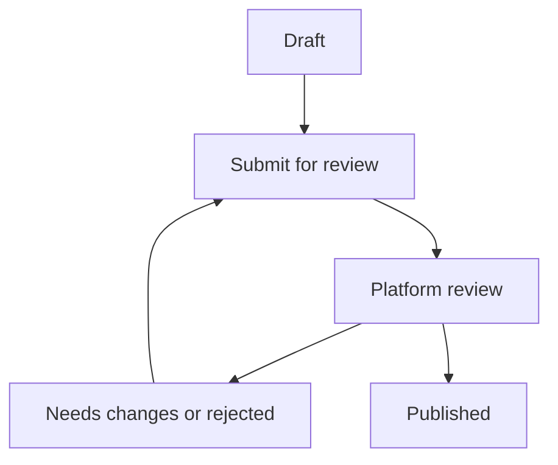

# Host an event

An organizer workspace keeps your events, team and delivery settings together. Publication uses platform review; saving a draft does not make an event visible in Discover.

## Create a workspace

Sign in, complete your profile, then choose Start hosting or the organizer workspace entry in navigation. Add a workspace name and an available URL name. Workspace membership controls who can edit events and manage the team.

Owner, Admin, Manager, Check-in and Finance are distinct roles. Event assignments further limit what a manager or check-in staff member can access. A workspace member does not automatically have platform administrator access.

## Build the event

Start with a clear title and short summary. Add the description, category, public or unlisted visibility, in-person/online/hybrid format, start and end times, and timezone.

For in-person or hybrid events, enter a useful city and venue/address. Maps and geocoding can assist with the entrance pin when configured, but a written venue/address remains important. Online and hybrid events also need the joining link required by publication validation.

The media page supports image upload progress, background processing, crop/aspect-ratio editing, gallery ordering, alt text, lineup profiles and PDF documents. Wait for image processing to complete and check the public preview. A decorative image cannot substitute for accurate event information.

## Set ticket inventory

Add at least one ticket type with its name, price and quantity. Set minimum/maximum quantities per booking and optional sale windows. A price of zero is Free; other prices are stored as integer paise and displayed in rupees.

Ticket inventory cannot exceed the configured event capacity. Hidden ticket types do not appear in the public selector. A ticket with stock can still be unavailable if its sale window has not opened, has ended, or the event is not published.

## Submit for review

The publication validator checks future start/end times, required location or joining information, ticket inventory/capacity, and a processed poster. Additional quality guidance helps an organizer review presentation without automatically rejecting subjective content.

Platform reviewers can approve, request changes or reject a submission with a reason. Published events can be suspended and restored through the implemented admin workflow. The review decision is recorded in an audit log.

Only approved published public events from active workspaces enter Discover. Unlisted events can be opened by their URL while published, but are excluded from public discovery. Draft, test, deleted, cancelled and suspended events are excluded.

> [!IMPORTANT]
> Review approval checks the submitted event and platform requirements. It is not a guarantee of organizer identity, event quality, insurance or regulatory compliance.

## Manage bookings and entry

The event workspace provides booking/attendee views, attendee export, ticket settings, staff assignment, messaging and check-in. At entry, authorized staff can scan a signed admission QR or search manually by guest details, ticket code or eligible booking reference.

Keep event staff on the correct event. Duplicate scans show an already-used result; cancelled/refunded or otherwise invalid admission is refused by the server. [Read the check-in guide](tickets-check-in.md).

## Configure delivery and payments

Local SMTP/Mailpit can test email without contacting customers. Production email needs a configured sender/provider. Official Meta WhatsApp and the optional linked gateway have separate setup, consent and operational requirements.

Cashfree payment collection is implemented. The repository does not implement an organizer bank-account onboarding or automated marketplace settlement/split-payments system. Agree how organizer funds are handled before accepting paid third-party events; the application does not prove a merchant settlement has reached an organizer.
